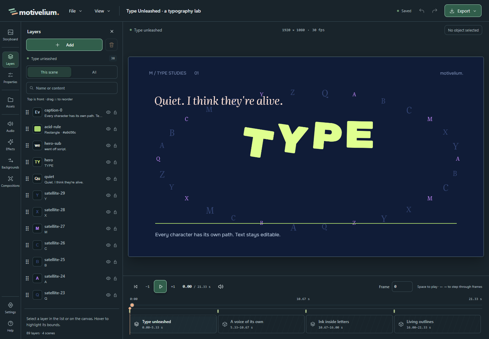
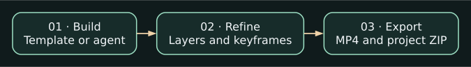
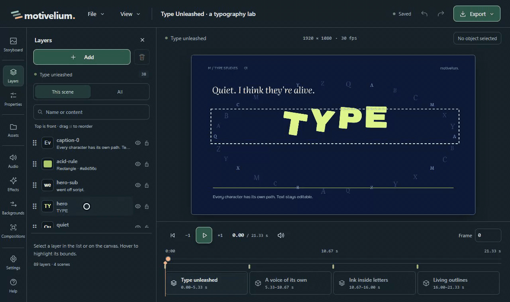

# Motivelium

By **androman** · [androman.pro](https://androman.pro) · [Telegram](https://t.me/andromanpro1c)

[Русский](README.md) · [Quick start](docs/FIRST_VIDEO.en.md) · [AI connection](docs/MCP.en.md)

**Build a scene with an AI agent or a template, then make it yours in the editor.**
In Motivelium, the result stays editable: move the title, adjust the camera,
set animation keyframes and export an MP4.

[**Download for Windows — beta.2**](https://github.com/andromanpro/motivelium/releases/tag/v0.2.0-beta.2)
· [Release notes and limitations](docs/RELEASE_BETA2.md)

## From an idea to a video

<picture>
  <source media="(max-width: 600px)" srcset="docs/showcase/workflow-en-mobile.svg">
  
</picture>

Watch: edit a title, then undo and redo the change (GIF)

## What you can make

- **An animated intro or presentation.** Start from a template, replace its
  text and images, set keyframes and check the rendered frames.
- **A video with an AI agent.** Give your agent a brief and assets over MCP.
  Review its preview, then refine the text, object positions or camera yourself.
- **A guided screen recording.** In beta.2, add a supported MP4 as a video layer
  and use ScreenGuide points for cursor movement, clicks and zoom.

## Try it without connecting an AI

Open **Examples → Type Unleashed**, create your own copy and select a text layer.
Change the title, apply the edit and try Undo. Once you like the result,
save the editable project as a ZIP or export an MP4.
[First video, step by step](docs/FIRST_VIDEO.en.md)

**Beta limits.** The build is for Windows. MP4 export requires Chrome,
FFmpeg and FFprobe. Video layers do not support every recording format.
[Requirements and limitations](docs/RELEASE_BETA2.md)

<!-- end-showcase -->

## Product inventory

[Existing capabilities](docs/CAPABILITIES.md) · [Development roadmap](docs/DEVELOPMENT.md)
(currently in Russian). The inventory distinguishes released features from
development and experimental work. Beta.2 includes [video layers](docs/VIDEO_CLIPS.md)
and [ScreenGuide: cursor, clicks and zoom](docs/SCREEN_GUIDE.en.md).

## Start with your AI or a template

Open Settings → AI and copy the MCP configuration into your own AI client. MCP provides catalogs, compact object queries, frame-based timing, storyboards, draft previews, real PNGs and short video, Apply/Undo, MP4 and project ZIP export. The bridge does not call a model or require the author's credentials.

Alternatively choose a template or create a storyboard. Applied text, images, groups, cameras and animation keys remain ordinary editable objects. Replace the materials, drag objects and refine the result.

Optional built-in GLM editing can inspect before/after frames and review a selected object within a bounded loop. It needs your own provider profile. Manual work and external MCP are separate connections.

## Languages and appearance

The studio, Help, four examples and three starter templates support English and Russian. A new profile follows the browser language; an explicit choice in Settings → Viewing is saved. System/light/dark appearance is independent of the project.

Examples and templates have separate content-language selectors. Switching UI language never translates your existing project or renames imported model parts. Some original technical diagnostics and asset names retain their source language.

## Windows requirements

The x64 Setup or complete portable package includes Node.js and runtime libraries. Setup requests UAC; the editor runs with ordinary user rights.

- Windows 10/11 x64, .NET Framework 4.8 and Microsoft Edge WebView2 Runtime.
- FFprobe for media import.
- Google Chrome, FFmpeg with libx264/AAC, and FFprobe for MP4.

External tools are installed separately. Check or select executable paths in Settings → Components. The installer is unsigned; Windows can display an unknown-publisher warning.

Installed data lives under %LOCALAPPDATA%/Motivelium, separately from program files. Updates and uninstalling preserve projects. Do not run independent servers against the same data folder. Move projects using ZIP, or inspect/copy another local library in Settings → Storage.

## Export and transfer

Export → MP4 video creates H.264/AAC from an immutable revision snapshot. Preview and export share the renderer and audio mix.

File → Download project creates a ZIP containing editable content and referenced media. Import creates an independent copy. Previous Undo history and finished MP4 files are not transferred.

## Source checkout

Use Node.js 24.12+ in the 24.x branch:

    node tools/setup.mjs
    node launch.mjs --check
    node launch.mjs

Checks:

    npm --prefix studio test
    npm --prefix studio run typecheck
    npm run test:browser
    py -3.14 tools/license-report.py --verify

Browser tests use isolated data and real Chrome/FFmpeg, without calling an LLM. Production is the default build.

This is a beta: static GLB/GLTF is supported; video layers accept supported
MP4 files, not every codec or recording format. See the [known issues](docs/KNOWN_ISSUES.md)
and [beta.2 release notes](docs/RELEASE_BETA2.md).

Own application code is MIT. Packages, shaders, models and media retain their licenses in THIRD_PARTY.md and licenses/. Personal projects, profiles, credentials and development laboratories are excluded from runtime packages.
