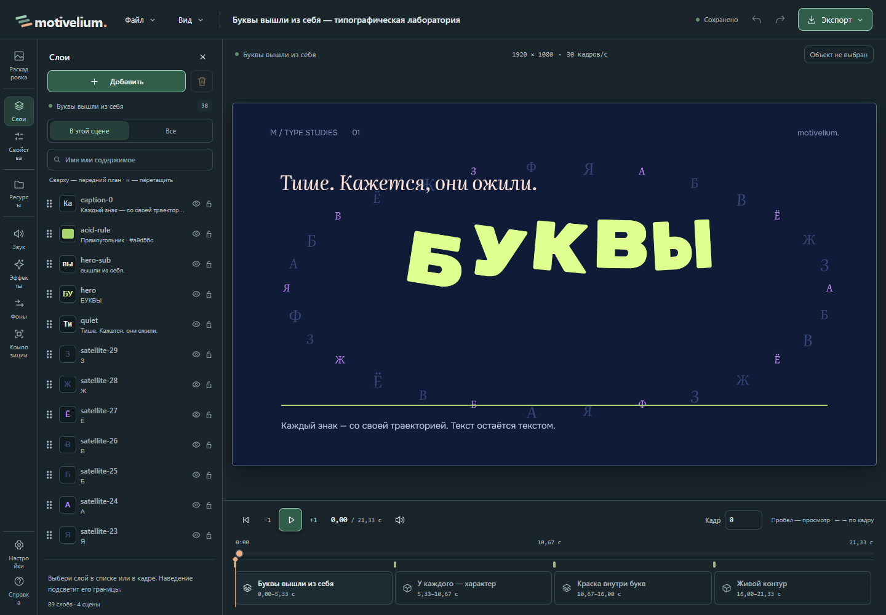
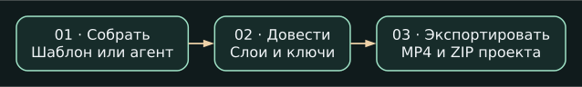
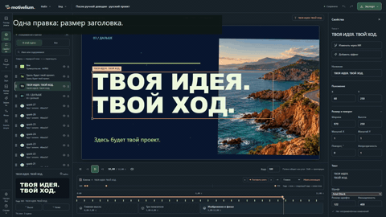

# Motivelium

Автор: **androman** · [androman.pro](https://androman.pro) · [Telegram](https://t.me/andromanpro1c)

[English](README.en.md) · [Первый ролик](docs/FIRST_VIDEO.md)

**Соберите сцену с ИИ или из шаблона, а потом доведите её руками.**
В Motivelium результат остаётся редактируемым проектом: можно подвинуть
заголовок, поменять камеру, добавить ключи анимации и выгрузить MP4.

[**Скачать для Windows — beta.2**](https://github.com/andromanpro/motivelium/releases/tag/v0.2.0-beta.2)
· [Что нового и ограничения](docs/RELEASE_BETA2.md)
· [Обзор с примерами](https://androman.pro/2026/10/30/motivelium-sdelay-krasivo-teper-chut-levee/)



## От замысла до ролика

<picture>
  <source media="(max-width: 600px)" srcset="docs/showcase/workflow-ru-mobile.svg">
  
</picture>

<details>
<summary>Посмотреть редактируемую сцену в движении (GIF)</summary>



</details>

## Что здесь можно сделать

- **Анимированная заставка или презентация.** Возьмите шаблон, замените текст
  и изображения, выставьте ключи и проверьте кадры.
- **Ролик с помощью агента.** Дайте ему материалы и задачу через MCP. Посмотрите
  примерку, а детали — текст, положение объектов, камеру — поправьте сами.
- **Акцент на записи экрана.** В beta.2 можно добавить поддерживаемый MP4 как
  слой и поставить точки ScreenGuide для курсора, щелчков и приближений.

## Что попробовать первым

Откройте **«Примеры» → «Буквы вышли из себя»**, создайте свою копию и выберите
текстовый слой. Поменяйте заголовок, примените изменение и проверьте отмену.
Так можно познакомиться со студией **без подключения ИИ**. Когда результат
устроит, сохраните редактируемый проект в ZIP или выгрузите MP4.
[Первый ролик по шагам](docs/FIRST_VIDEO.md)

**Границы беты.** Сборка для Windows. Для MP4 нужны Chrome, FFmpeg и FFprobe;
видеослои поддерживают не все форматы. [Требования и ограничения](docs/RELEASE_BETA2.md)

<!-- end-showcase -->

## Карта продукта

[Что уже реализовано](docs/CAPABILITIES.md) · [Перспективные ветки](docs/DEVELOPMENT.md).
Карта отделяет опубликованные функции от рабочих и экспериментальных.
В beta.2 доступны [видеослои](docs/VIDEO_CLIPS.md) и
[ScreenGuide: курсор, щелчки и приближение](docs/SCREEN_GUIDE.md).
Для знакомства начните со встроенного примера; затем можно подключить своего ИИ по MCP.

## Язык и оформление

Русский и English, системная/светлая/тёмная тема. Четыре примера и три шаблона доступны на обоих языках. Язык контента выбирается отдельно; существующие проекты не переводятся автоматически. Исходные имена деталей моделей и технические подробности сохраняют язык источника.

## Два пути к ролику

**Через внешний ИИ.** В настройках студии откройте «ИИ», скопируйте конфигурацию MCP в свой клиент и дайте ему замысел и материалы. MCP предоставляет каталоги, компактные выборки объектов, рецепты времени, раскадровку, примерку, реальные PNG/короткое видео, применение, отмену, MP4 и ZIP. Подробности — [MCP.md](docs/MCP.md). Этот мост сам не вызывает модель и не требует ключей автора.

**Из шаблона или раскадровки.** Откройте шаблон либо запишите план в раскадровке. «Собрать монтаж» предлагает три приёма с живой примеркой. Применённые тексты, картинки, группы, ключи и камера остаются обычными объектами. Заменяйте материалы, двигайте объекты на холсте, меняйте размер, порядок и анимацию.

Необязательная встроенная правка выбранного объекта через GLM видит кадры до/после и умеет ограниченную самопроверку. Для неё нужен собственный профиль. Внешний MCP и встроенный GLM — разные подключения; ручная работа доступна без модели.

## Первый запуск

[Короткий маршрут со скриншотами](docs/FIRST_VIDEO.md): открыть пример, заменить материалы, подключить своего ИИ, проверить отмену, получить MP4 и перенести ZIP. Встроенная справка доступна без сети. В «Настройки → Компоненты» проверяются Chrome/FFmpeg/FFprobe; в «Хранилище» видна папка данных и можно перенести проект из другой папки отдельной копией. Просмотр встроенных примеров не создаёт проекты.

## Что можно править

- Сцены, группы, текст, изображения, порядок и положение объектов, размер и ключи анимации.
- Эффекты, переходы между двумя сценами, маски, шейдеры и готовые композиции с примеркой.
- Статические GLB/GLTF: детали, сборка и разборка, камера, материалы, свет и атмосфера.
- Музыку, голос и эффекты: несколько дорожек, уровни, отключение и смещения. Общий PCM-микс используется в просмотре и экспорте.
- План и ключевые кадры, замечания, связи со сценами и сравнение версий.

Изменения проходят через ревизии и общую историю. Примерка не меняет исходный проект до применения. Устаревшая правка отклоняется; её нельзя молча наложить на новую версию.

Раскадровка может быть только планом. Отдельный HTML-ролик не становится
редактируемым монтажом от наличия карточек в студии. В beta.2 можно добавить
поддерживаемый MP4 как слой; [ограничения форматов и размера](docs/VIDEO_CLIPS.md).

## Запуск

Windows x64: EXE и Setup содержат Node и библиотеки. **Windows запросит подтверждение прав администратора (UAC)** для установки; редактор запускается обычным способом из «Пуска». Нужны .NET Framework4.8 и WebView2 Evergreen. Для своих медиа нужен FFprobe; для MP4 — Chrome, FFmpeg с libx264/AAC и FFprobe. Эти компоненты устанавливаются отдельно. Setup/EXE пока без подписи доверенного издателя.

Из исходников нужен Node24.12+ в ветке24.x:

```text
node tools/setup.mjs
node launch.mjs --check
node launch.mjs
```

В установленной программе данные хранятся в `%LOCALAPPDATA%/Motivelium`, отдельно от файлов программы. Обновление и удаление программы сохраняют проекты. Старый переносимый комплект/исходники могут использовать свою `.local`; переносить проекты между компьютерами следует через ZIP; на одном компьютере доступен предварительный просмотр переноса из другой папки в настройках хранилища. Не запускайте два независимых сервера с одной папкой данных.

## Экспорт и перенос

«Экспорт → Видео MP4» создаёт H.264/AAC. Передаётся неизменяемый снимок ревизии; готовый файл проверяется по параметрам и числу кадров. «Файл → Скачать проект» сохраняет ZIP текущего документа со всеми ресурсами. На другом компьютере импортируется отдельная копия; история отмен и готовые MP4 не переносятся.

В настройках хранилища можно очистить промежуточные кадры и копии ресурсов старых завершённых экспортов. Исходные проекты, история, оригиналы и готовые MP4 сохраняются. Границы формата, 3D и компонентов — [KNOWN_ISSUES.md](docs/KNOWN_ISSUES.md).

## Разработка

`studio/domain` — документ и операции; `studio/render` — общий расчёт/рисование; `server` — хранение, ИИ, медиа и экспорт; `mcp` — внешнее создание; `desktop` — Windows; `templates` — встроенные заготовки. Версия задаётся в `version.json`, производные обозначения синхронизирует `node tools/sync-version.mjs`.

```text
npm --prefix studio test
npm --prefix studio run typecheck
npm run test:browser
py -3.14 tools/license-report.py --verify
```

Последнюю команду реестра запускать Python3.14: `py -3.14 tools/license-report.py --verify` на Windows. Браузерная проверка использует отдельное хранилище, настоящий Chrome/FFmpeg и не вызывает LLM. Production-сборка — по умолчанию, `--development` включает режим разработки; `--out-dir PATH` позволяет собирать отдельно. Штатные тесты не заменяют художественный просмотр и внешние Windows/GPU-пробы.

Собственный код — [MIT](LICENSE). Полные условия библиотек, шейдеров, моделей и материалов — [THIRD_PARTY.md](THIRD_PARTY.md) и `licenses/`. Личные проекты, профили, ключи, журналы и лабораторные фильмы в поставку автоматически не включаются.
