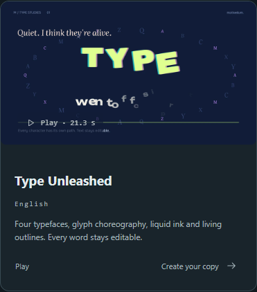
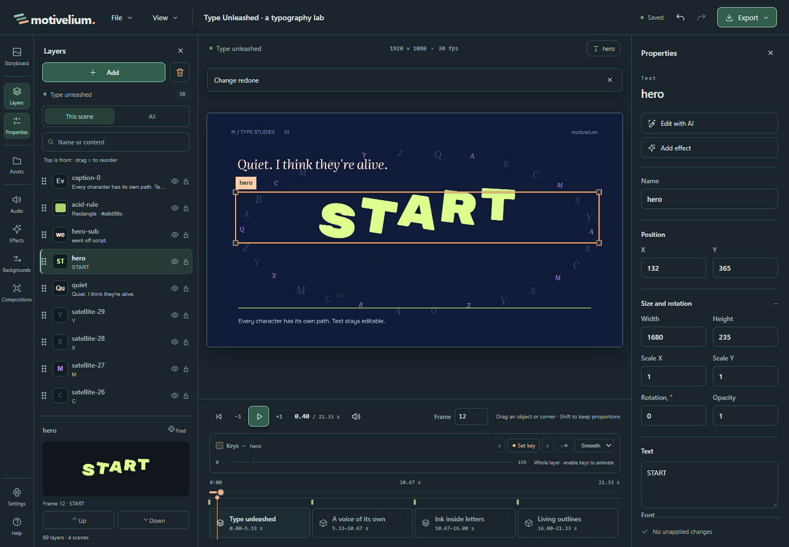
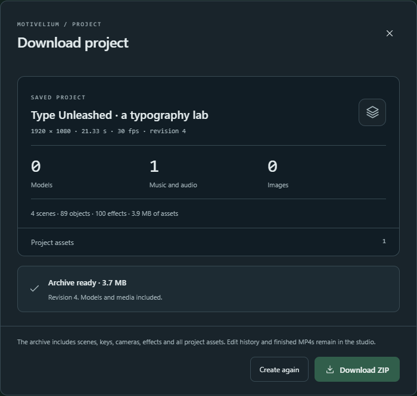

# Worked example: turn an animated scene into your own intro

[Русский](CASE-ANIMATED-INTRO.md) · [Your first video](FIRST_VIDEO.en.md)

**Scenario.** You need an intro that says “START”. The built-in example
already has the motion and composition you want. Keep those, replace the
title, and share an editable project so someone else can continue the work.

**Before you start.** Use Motivelium 0.2.0-beta.2 with its built-in examples.
You do not need an AI connection or any imported assets.

## 1. Make a copy of the example

On the home screen, open **Examples**, set **Example language** to English
and find **Type Unleashed**. Choose **Create your copy**. This opens a
separate editable project without changing the bundled example.

## 2. Change the title and check your edit

In **Layers**, select `hero`, the large title on the canvas. In
**Properties**, change its text to **START** and choose **Apply changes**.
Keep the existing layer: that retains its styling and animation. Check the
title on the canvas and scrub the scene to see it at different frames.

Choose **Undo** to bring the original title back, then **Redo** to restore
**START**.

## 3. Share an editable project

Choose **File → Download project…**, review the contents and choose
**Create archive**. When you see **Archive ready**, choose **Download ZIP**.
To verify the handoff, choose **File → Import project…**, select the ZIP
and choose **Import copy**. Open the `hero` layer and check that it says
“START”. The ZIP contains saved scenes and their assets; it does not carry
over the undo history or a rendered video.

**Expected result.** Your project copy has the “START” title and the bundled
example is untouched. Share the ZIP to hand off editing. If you need a file
for viewing instead, use [MP4 export](FIRST_VIDEO.en.md#export-and-transfer).
