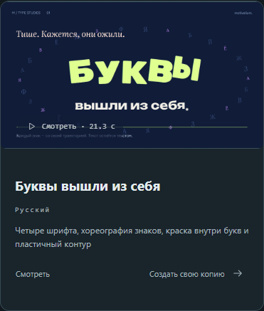
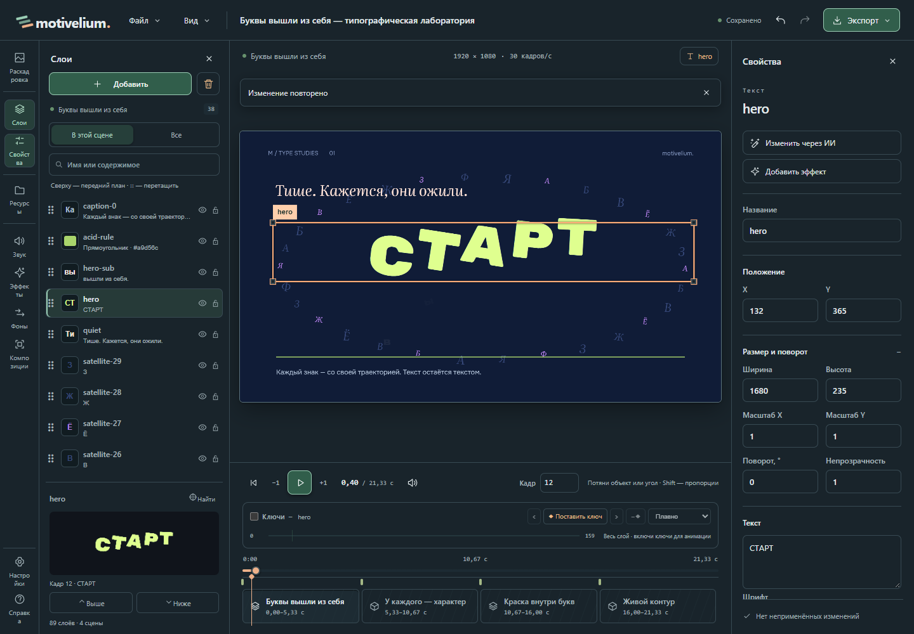
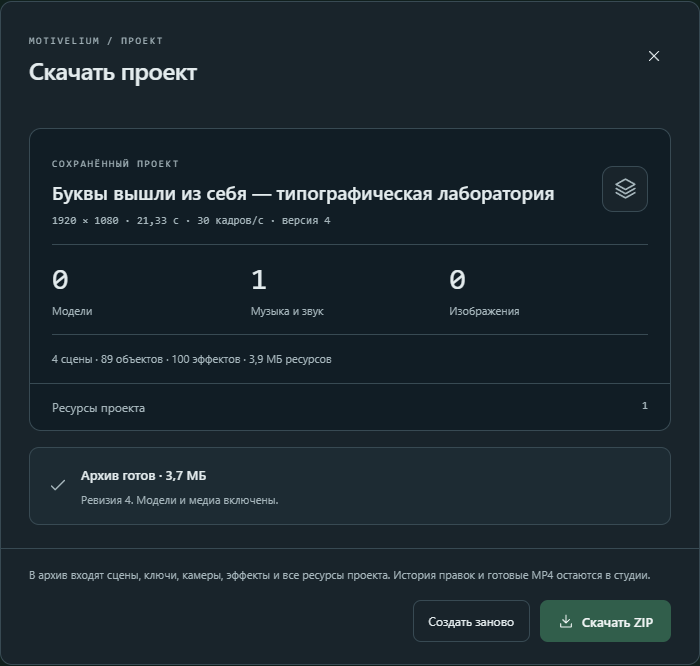

# Практический кейс: переделать анимированную сцену под свою заставку

[English](CASE-ANIMATED-INTRO.en.md) · [Первый ролик](FIRST_VIDEO.md)

**Ситуация.** Нужна заставка с надписью «СТАРТ». У встроенного примера уже
есть движение букв и композиция: их оставим, а текст заменим. В конце
сохраним копию проекта, чтобы другой человек мог продолжить монтаж.

**Перед началом.** Нужен Motivelium 0.2.0-beta.2 со встроенными примерами.
Для этого упражнения не нужно подключать ИИ или импортировать свои материалы.

## 1. Создайте копию примера

На главной откройте **«Примеры»**, выберите русский язык примеров и найдите
**«Буквы вышли из себя»**. Нажмите **«Создать свою копию»**. Это откроет
отдельный редактируемый проект; встроенный пример не изменится.

## 2. Замените текст и проверьте правку

В **«Слоях»** выберите `hero` — это крупный заголовок на холсте. В
**«Свойствах»** замените его текст на **СТАРТ** и нажмите **«Применить
изменения»**. Не удаляйте слой и не создавайте новый: так сохранятся его
оформление и анимация. Проверьте титр на холсте и перемотайте сцену,
чтобы увидеть его на разных кадрах.

Нажмите **«Отменить»**: должен вернуться исходный текст. Затем
**«Повторить»**: снова должна появиться надпись **СТАРТ**.

## 3. Передайте редактируемый проект

Откройте **«Файл → Скачать проект…»**, проверьте состав и нажмите
**«Создать архив»**. Когда появится **«Архив готов»**, нажмите **«Скачать
ZIP»**. Чтобы проверить передачу, выберите **«Файл → Импортировать
проект…»**, укажите ZIP и нажмите **«Импортировать копию»**. Откройте
слой `hero`: в нём должна быть надпись «СТАРТ». В архив входят
сохранённые сцены и их ресурсы, но не история отмен и не готовый ролик.

**Что должно получиться.** В копии проекта надпись «СТАРТ», а исходный
пример не затронут. ZIP можно передать для продолжения работы. Если
нужен файл для просмотра, а не монтажа, используйте
[экспорт MP4](FIRST_VIDEO.md#получите-mp4-и-zip).
