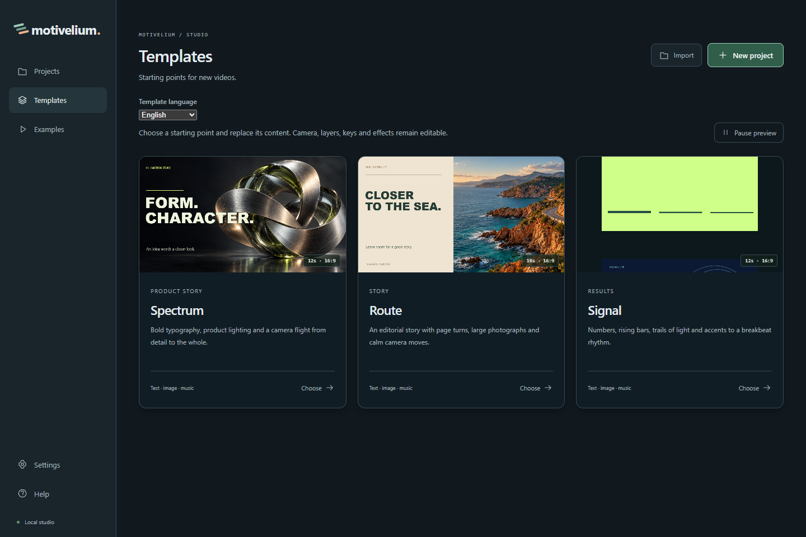
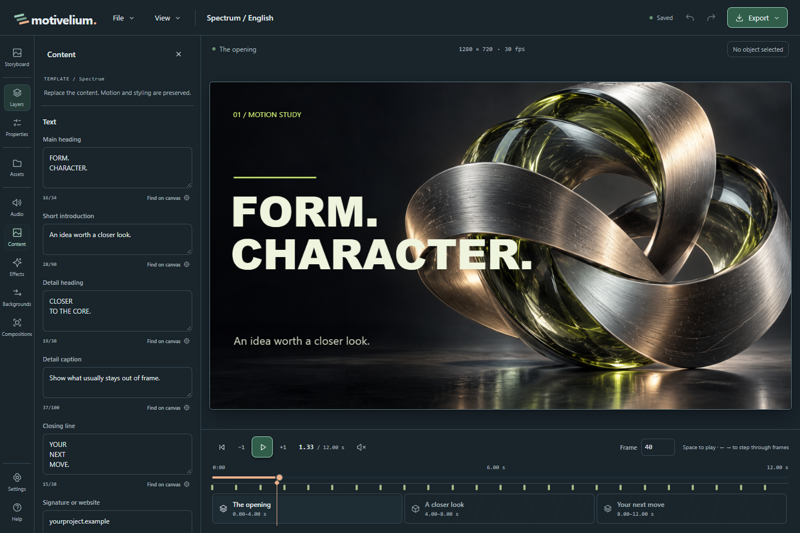
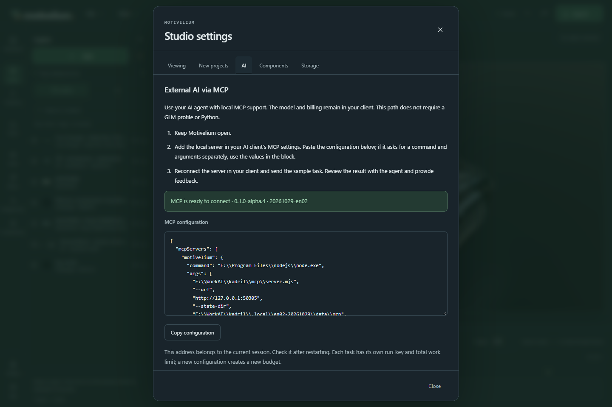
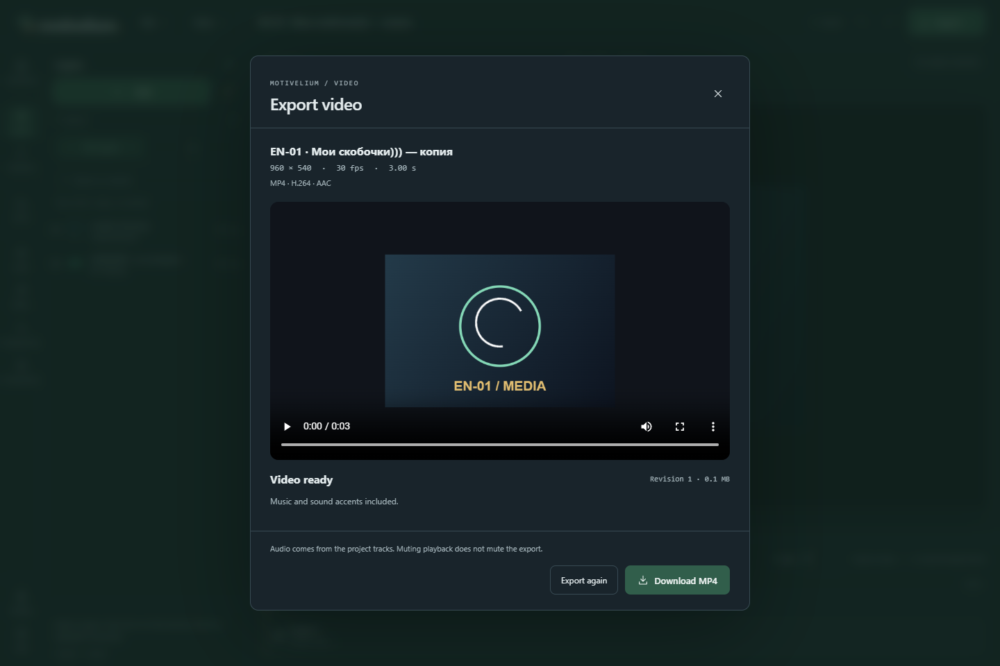

# Your first video in Motivelium

[Русский](FIRST_VIDEO.md) · [MCP connection](MCP.en.md)

## Open a starting point

In **Templates**, choose **Template language → English**, preview Spectrum, Route or Signal, then create your own project. The original stays intact.

In **Examples**, choose **Example language → English** to preview Type Unleashed, One Strike, Matter or Set Ideas in Motion. Previewing does not save a project; Create your copy does.

## Replace content

Open Content to edit named text slots. Apply the text and check the frame. Use Assets to import an image or audio; image slots can update the corresponding image across scenes.

Select a layer on the canvas or in Layers. Edit Properties, drag, resize or set keys. Apply commits the draft. Undo/Redo are in the top bar.

## Connect an AI

Open Settings → AI and copy the MCP configuration into your own client. Describe the purpose, duration, materials and style. Ask the agent to inspect rendered previews before applying changes.

Built-in Edit with AI is an optional separate connection. It proposes edits to a selected object; you decide whether to apply them.

## Export and transfer

Check Settings → Components. MP4 needs Chrome, FFmpeg and FFprobe. Open Export → MP4 video, create the export, wait for Video ready and download. Keep the studio running while a job is active.

Play the file and check picture and sound. File → Download project creates a ZIP with the document, models, images and audio. File → Import project creates an independent copy on another computer.

Language and appearance are local preferences. Your authored project text stays as written.
