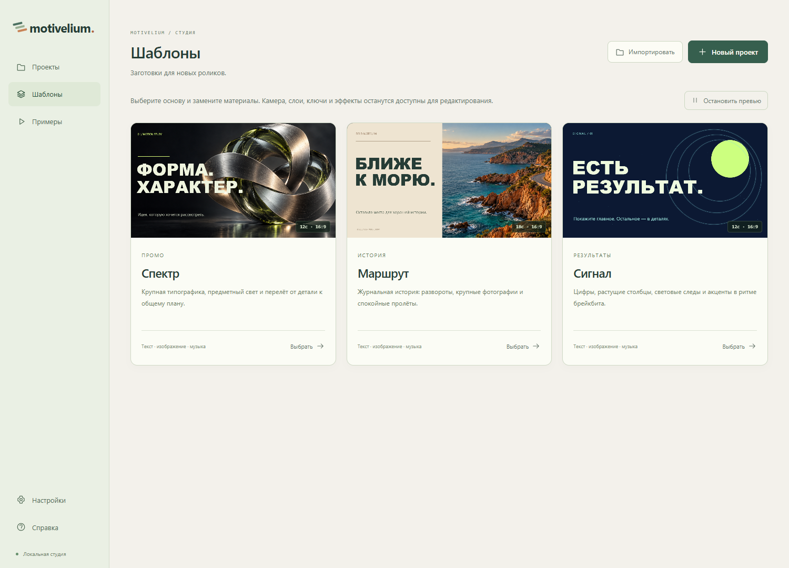
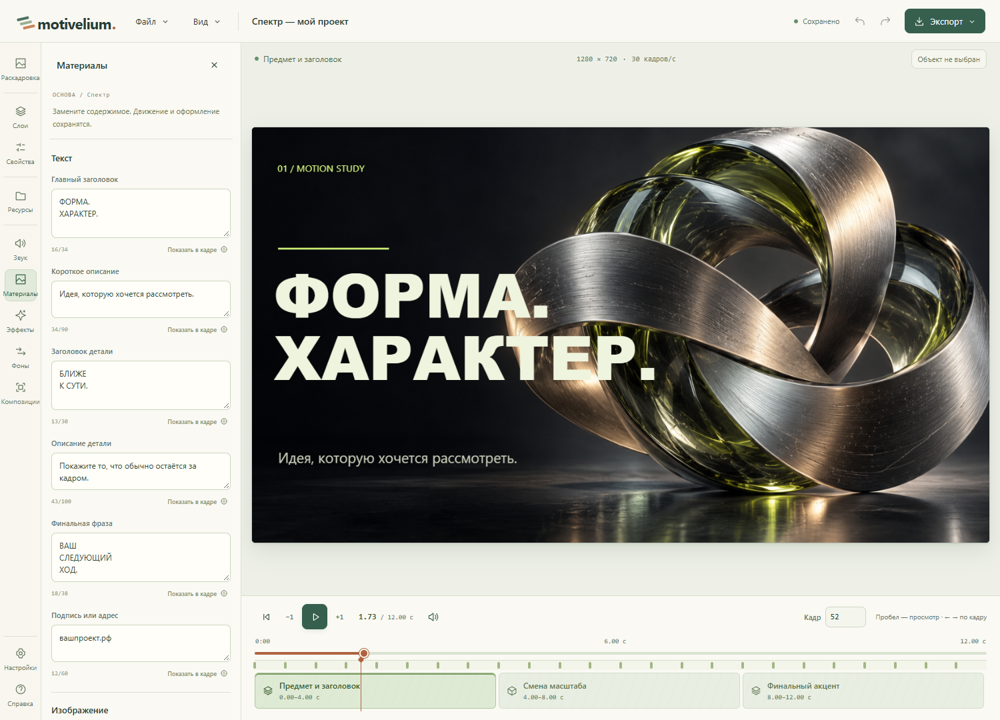
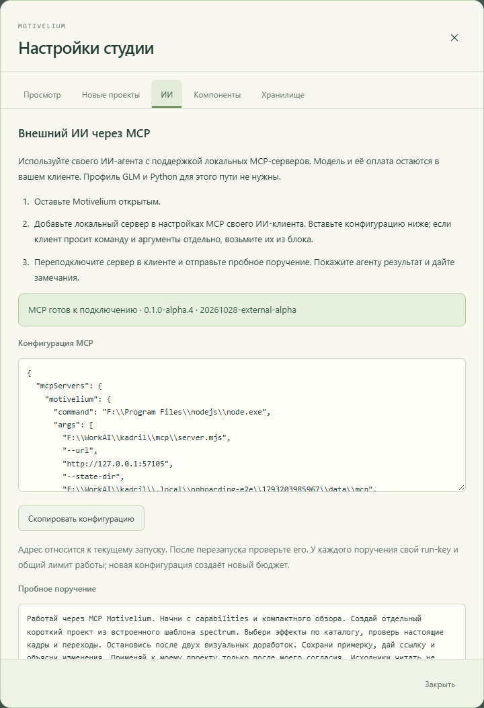
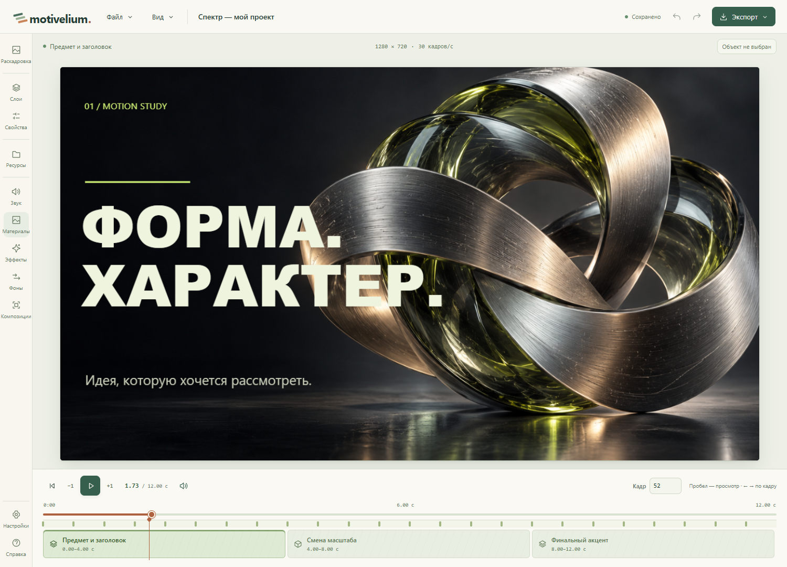
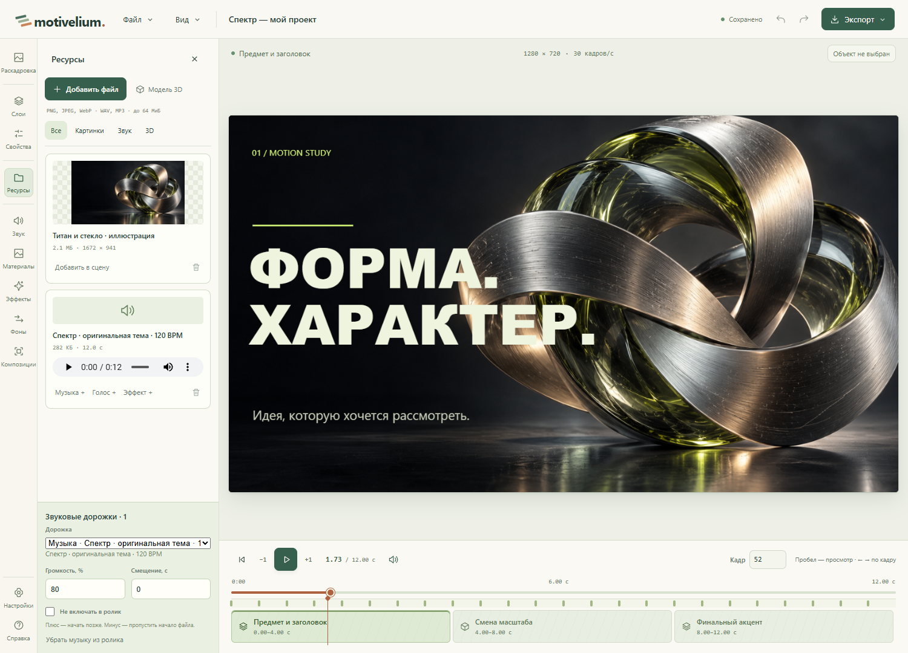
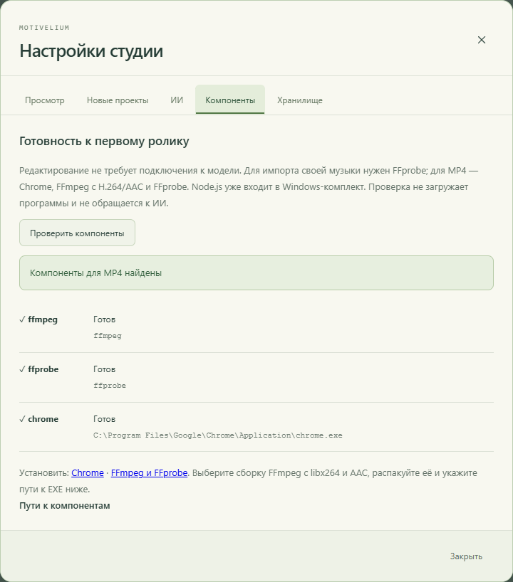
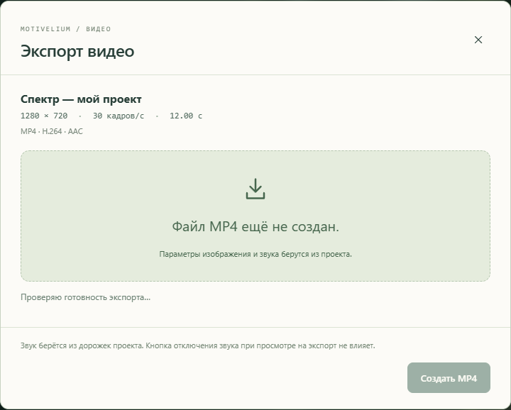

# Первый ролик в Motivelium beta.1

Этот маршрут относится к0.2.0-beta.1, сборка `20261030-beta1`. Установщик и portable доступны в [выпуске GitHub](https://github.com/andromanpro/motivelium/releases/tag/v0.2.0-beta.1). Прежняя alpha.3 не содержит MCP.

## Откройте пример

Запустите Motivelium из «Пуска». В разделе «Примеры» нажмите на обложку: просмотр не создаёт проект. Перематывайте, выбирайте главы, включите звук. Затем нажмите «Создать свою копию». Четыре примера и три шаблона входят в комплект и работают без сети; у встроенного содержимого есть русские и английские варианты.

Для первого собственного ролика удобен шаблон «Спектр». Панель «Материалы шаблона» позволяет заменить заголовки, изображение и музыку. Слои, камера, ключи и эффекты остаются редактируемыми.

## Подключите своего ИИ

Откройте **Настройки → ИИ**. Оставьте студию запущенной, скопируйте конфигурацию MCP в настройки локальных MCP-серверов своего ИИ-клиента. Если клиент принимает команду и аргументы отдельными полями, перенесите соответствующие значения из JSON. Переподключите сервер в клиенте.

Модель вызывается и оплачивается вашим клиентом. Внешний MCP не требует профиля GLM, Python или ключей автора. Встроенные правки одного выбранного объекта через GLM — отдельная необязательная функция.

Скопируйте пробное поручение из настроек. Для открытого проекта в нём уже указан нужный идентификатор. Агенту доступны capabilities, компактный обзор, каталог эффектов, реальные PNG, короткий проход и примерка. Попросите остановиться после двух визуальных доработок и показать результат перед применением.

Если студия перезапущена, проверьте адрес в конфигурации. Новый run-key начинает новый бюджет поручения; повторное подключение с прежним ключом продолжает прежний бюджет. Подробности: [MCP](MCP.md).

## Доведите руками и проверьте отмену

Выберите объект на холсте или в «Слоях». Переместите мышью, измените размер за углы. Для движения поставьте ключи на разных кадрах. После применения изменения нажмите «Отменить» или Ctrl+Z; «Повторить» вернёт правку.

Своё изображение или музыку загрузите в «Ресурсы». Импорт музыки требует FFprobe. Обычный MP4 пока не добавляется в сцену как редактируемый видеослой.

## Получите MP4 и ZIP

В **Настройки → Компоненты** нажмите «Проверить компоненты». Для MP4 нужны Chrome, FFmpeg с libx264/AAC и FFprobe. На этом экране есть ссылки на загрузку и поля абсолютных путей. После сохранения путей перезапустите эту копию студии. Автоматическая загрузка и установка сторонних программ не выполняются.

**Экспорт → Видео MP4**: запустите экспорт, дождитесь готовности, скачайте файл и посмотрите его со звуком. Пока идёт задание, оставьте студию открытой.

**Файл → Скачать проект** сохраняет ZIP текущего документа со всеми его ресурсами. На главной другой студии выберите «Импортировать», проверьте состав и создайте копию. История отмен и готовые MP4 остаются в исходной студии.

## Где проекты из другого запуска

Установленная программа обычно хранит данные в `%LOCALAPPDATA%/Motivelium`; исходники и переносимый комплект могут использовать свою `.local`. Разные папки не означают удаления проектов.

В **Настройки → Хранилище** виден активный путь. Разверните «Перенести проекты из другой папки», укажите другую папку данных либо её подпапку projects. В EXE есть выбор папки. После проверки выберите проект и нажмите «Перенести копию». Состояние и ресурсы проверяются, создаётся отдельный проект; исходная папка и уже существующие проекты не перезаписываются. Если источник изменился после просмотра, проверьте его заново. Между компьютерами используйте ZIP.

## Если что-то не получилось

Сообщите версию и build ID, Windows и видеокарту, действие, номер кадра и точный текст ошибки. Отдельно отметьте, где понадобилась помощь. Не прикладывайте ключи, личные переписки или материалы без необходимости. [Маршрут и форма обратной связи](ALPHA_TEST.md).
