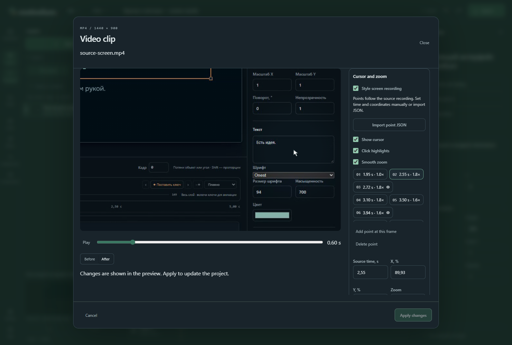

# Cursor, clicks and smooth zoom

Development build after beta.1; not included in the published beta.1 installer. [Русский](SCREEN_GUIDE.md).

Style an existing recording with editable focus points, a cursor, click rings and smooth zoom. This feature does not capture the desktop or detect actions from video pixels.

1. Import a supported MP4 in **Resources**, add it to a scene and select its video layer.
2. Open **Properties → Video: trim and styling → Cursor and zoom**. Enable **Style screen recording**.
3. Seek to an action and choose **Add point at this frame**. Time uses seconds in the **original recording**; X/Y are percentages of the full source image. **Place point on frame** also accounts for the layer transform, fitting and zoom.
4. Set zoom from 1× to 3×. Two consecutive identical points hold the view. A point with 1× returns to overview. The source camera stays inside the recording boundaries.
5. Enable a click at the point for a short ring. Cursor, clicks and zoom are independent. Background dimming, focus radius and accent colour are editable.
6. Play or seek, compare **Before/After**, then apply. The live project stays unchanged until Apply. Undo restores the entire edit and Redo restores the applied result. Cancel discards the preview. Revision conflicts prevent applying a stale draft.

If a cursor is baked into the video, disable the additional cursor to avoid duplicates. Click rings do not generate sound: place a separate sound track or use MCP `propose_sound`.

Points follow trim and speed because their times belong to the source recording. Points outside the current trim remain editable; points outside the file duration are rejected. Hold freezes the guide with the last frame. Camera interpolation is deterministic: seeking and exporting use the same calculation.

**Import point JSON** accepts the full `ScreenGuide` object, up to 32 KiB and 80 strictly increasing points. The [Russian guide](SCREEN_GUIDE.md) includes a complete JSON example: `cursor/clicks/autoZoom` are booleans, `dim` is 0..0.7, `radius` is 0.05..0.5, `color` is #rrggbb. Each point has `time` in source seconds, normalised `x/y` (0..1), `zoom` (1..3), and boolean `click`.

For an AI agent: `capabilities(section:"screencast")` → select a video using `list_nodes` → `propose_screen_guide(projectId,expectedRevision,nodeId,guide)` → `render_preview/render_clip` on the returned `draftId` → `apply_draft`. Read points in compact pages with `list_nodes(ids:[nodeId],detail:"screen-points",offset,limit)`. `guide:null` removes styling; `updateNode(values.screenGuide)` is also supported. The ordinary iteration budget, conflict checks and Undo/Redo apply.

Points and styling stay editable in the project and ZIP. Packages require `screen-guide-v1`, so incompatible readers request an update. The studio, MCP and MP4 share the renderer and decoder. MCP motion previews are silent; full MP4 uses the common audio mix. See [video clip limits](VIDEO_CLIPS.md) for supported files.
