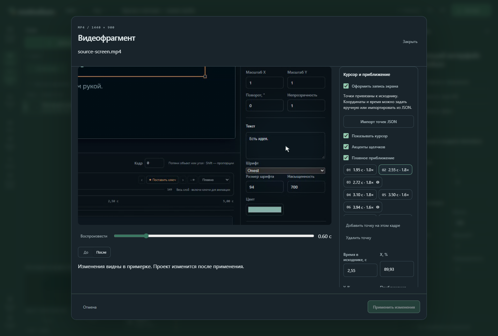

# Курсор, щелчки и приближение

Рабочая сборка после beta.1. Эти функции ещё не входят в опубликованный установщик. [English](SCREEN_GUIDE.en.md).

Приближение работает внутри видеослоя: остальные подписи и объекты сцены не смещаются. Общая камера проекта может дополнительно двигать всю композицию.

Это оформление готовой записи: ИИ или человек расставляет точки внимания, а общий рендерер рассчитывает плавное приближение, курсор и акценты щелчков. Встроенного захвата экрана и распознавания действий по пикселям пока нет.

## В студии

1. Импортируйте MP4 через «Ресурсы», добавьте его в сцену и выберите видеослой.
2. Откройте **Свойства → Видео: обрезка и оформление → Курсор и приближение**. Включите «Оформить запись экрана».
3. На нужном кадре нажмите «Добавить точку на этом кадре». Время задаётся в секундах **исходной записи**, X/Y — в процентах исходного изображения. Можно выбрать точку и нажать «Поставить точку на кадре», затем щёлкнуть по цели в примерке. Учитываются размещение слоя, общий план и приближение.
4. Задайте масштаб от 1× до 3×. Две соседние точки с одинаковыми X/Y/масштабом удерживают план; точка с 1× возвращает общий вид. Координаты камеры ограничены краями записи.
5. Отметьте «Щелчок в точке» для короткого кольца. Курсор, кольца и приближение можно отключать независимо; приглушение фона, радиус внимания и цвет редактируются отдельно.
6. Перематывайте или воспроизводите, сравните «До/После». Проект изменится только после «Применить изменения». Вся правка отменяется одним Undo; Redo её восстанавливает. Закрытие или «Отмена» не сохраняют примерку. Изменившаяся ревизия блокирует применение устаревшего варианта.



Если курсор уже записан в пикселях MP4, выключите дополнительный курсор: скрыть исходный указатель этим механизмом нельзя. Метка «Щелчок» рисует акцент, но не добавляет звуковую дорожку. Звук ставится отдельно в общей панели звука или через MCP `propose_sound`.

## Время и импорт JSON

Точки привязаны к исходнику: начало записи — 0, независимо от `sourceIn` и скорости слоя. При обрезке/ускорении они показываются вместе с соответствующим действием. Точки за обрезанным диапазоном сохраняются для последующей доводки; вне длительности исходного файла — отклоняются. При удержании последнего кадра движение и акценты тоже останавливаются на конечном времени.

«Импорт точек JSON» принимает полный объект `ScreenGuide`, до 32 КиБ. До 80 точек, время строго возрастает; X/Y от 0 до 1, масштаб 1..3. Удобно сначала разместить несколько точек через MCP, затем поправить их на холсте.

```json
{
  "cursor": true, "clicks": true, "autoZoom": true,
  "dim": 0.22, "radius": 0.25, "color": "#a6edd7",
  "points": [
    {"time": 0,   "x": 0.5, "y": 0.5, "zoom": 1,   "click": false},
    {"time": 1,   "x": 0.7, "y": 0.4, "zoom": 1.8, "click": true},
    {"time": 2,   "x": 0.7, "y": 0.4, "zoom": 1.8, "click": false},
    {"time": 3.5, "x": 0.5, "y": 0.5, "zoom": 1,   "click": false}
  ]
}
```

## Через MCP

1. `capabilities({"section":"screencast"})` — краткий рецепт и единицы измерения.
2. `list_nodes({"projectId":"…","kind":"video"})` — выбрать видеослой.
3. `propose_screen_guide({"projectId":"…","expectedRevision":3,"nodeId":"screen","guide":{…}})` — неизменяемая примерка. `guide` имеет формат JSON выше; `guide:null` удаляет оформление. Обычный `updateNode(values.screenGuide)` также поддерживается.
4. `render_preview` и `render_clip` с возвращённым `draftId`. Проверяйте кадры до/после действия, движение и последний кадр. Короткий MCP-клип без звука; полный MP4 использует общий микс.
5. `apply_draft`, затем при необходимости `undo`/`redo`. Общий бюджет итераций распространяется и на этот инструмент.
6. `list_nodes({"projectId":"…","ids":["screen"],"detail":"screen-points","limit":8})` читает точки отдельными страницами с `nextOffset`; не нужно получать весь граф.

Настройки и точки — часть видеослоя, сохраняются в проекте/ZIP и остаются редактируемыми после импорта. ZIP объявляет требование `screen-guide-v1`: старый читатель должен попросить обновиться. Декодирование и расчёт одинаковы в студии, MCP и экспорте. Ограничения MP4 перечислены в [VIDEO_CLIPS.md](VIDEO_CLIPS.md).

Поручение агенту: «Приблизь поле ввода перед изменением заголовка, удержи читаемый план, выдели нажатие “Применить”, затем покажи результат и верни общий вид. Сначала покажи примерку. Не добавляй бесконечное слежение за мышью. После применения всё должно остаться редактируемым».
